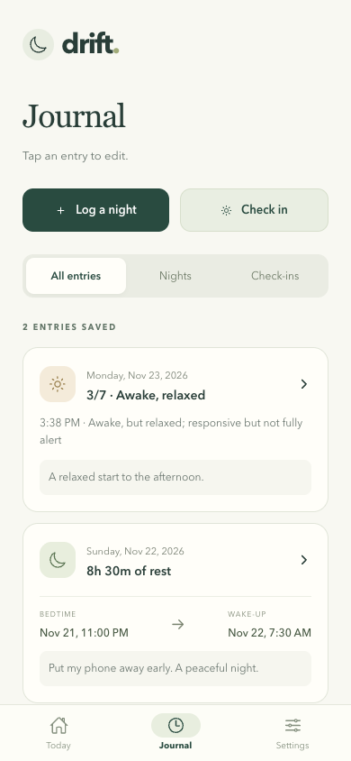

# Drift

A mobile sleep journal built with Angular, Ionic, and Capacitor. Track overnight sleep, record daytime sleepiness, and review your week without creating an account.

Built by Kevin Zhong.

<p>
  
  
</p>

[Watch the demo](demo.webm)

## Features

- **Overnight logging:** bedtime and wake-up dates, a duration preview, and optional notes.
- **Sleepiness check-ins:** all seven Stanford Sleepiness Scale ratings, with descriptions and editable timestamps.
- **Weekly overview:** daily sleep totals, average per logged day, and recent entries. Missing days are excluded from the average.
- **Editable journal:** filter by entry type, update past entries, and delete with confirmation and Undo.
- **Local storage:** entries and your sleep goal persist across reloads using Capacitor Preferences.
- **Backup and restore:** export a JSON file and merge missing entries back into your journal.
- **Device reminders:** optional daily notifications that open a check-in when tapped. Implemented for Capacitor; device testing is still pending.

## Run locally

Use Node.js 20.19+ and npm.

```sh
git clone https://github.com/woshizgr58/drift-sleeptracker.git
cd drift-sleeptracker/sleeptracker
npm ci
npm start -- --port 8100
```

Open **http://localhost:8100**. No API keys or backend setup are required.

```sh
npm run build
```

The production bundle is generated in `sleeptracker/www`.

## Android

The repository includes a Capacitor Android project. Install Android Studio, the Android SDK, and JDK 21, then run these commands from `sleeptracker`:

```sh
npm run build
npx cap sync android
npx cap open android
```

Run the app on a device or emulator from Android Studio. In **Settings**, enable a daily reminder and grant notification permission. Use **Test in 10 seconds**, background the app, and tap the delivered notification to test the check-in flow. Android may delay notifications under power-saving restrictions.

The browser app has been tested; the native build and notification delivery have not yet been verified on hardware or an emulator. An iOS project is not included.

## Development

Run these commands from `sleeptracker`:

| Command | Purpose |
| --- | --- |
| `npm start` | Start the development server |
| `npm run build` | Create a production build |
| `npm run lint` | Check TypeScript and templates |
| `npm test -- --watch=false --browsers=ChromeHeadless` | Run Angular unit tests; requires Chrome |
| `npm run test:e2e` | Run Playwright browser tests |
| `npm run format` | Format source and test files |
| `npm run demo` | Record a browser walkthrough |

Playwright uses Google Chrome on macOS when installed. Otherwise, install its Chromium browser first:

```sh
npx playwright install chromium
npm run test:e2e
```

To record a new demo, leave the app running on port 8100, install the recording dependency with `npx playwright install ffmpeg`, then run `npm run demo`. This creates `demo.webm` and updates screenshots in `artifacts/`.

The most recent verification passed the production build, lint, six Angular unit tests, and five browser tests. Browser coverage includes logging, reload persistence, editing, delete/Undo, backup restoration, invalid dates, overlapping entries, storage failures, and layouts from 320 to 1440 pixels wide.

## How it works

The interface uses Angular signals for journal state and computed summaries. `SleepService` loads a versioned JSON journal and completes storage writes before reporting success, so failed writes leave the form available for retry. `ReminderService` handles notification permissions, scheduling, cancellation, and opening a check-in from a notification.

```text
sleeptracker/
  src/app/home/        Screens and logging forms
  src/app/services/   Journal persistence and native reminders
  src/app/data/       Original data models and scale descriptions
  src/theme/          App colors and typography
  android/            Capacitor Android project
  e2e/                Browser tests
  scripts/            Demo recording
artifacts/            App screenshots
demo.webm             Browser walkthrough
```

## Data and limitations

Your journal stays on your device. Capacitor Preferences uses browser localStorage on the web and native preferences storage on supported mobile platforms. Clearing browser data or uninstalling the app can remove entries, so export a backup if you want a separate copy.

Restore adds records whose IDs are missing; it keeps existing records and your current sleep goal. There is no account system, cloud sync, or automatic sleep detection. Drift records your own observations and is not a medical assessment tool.

The current Angular 19 dependency tree has known npm audit advisories. Dependency updates and native-device verification are remaining work before a production release.

## Background and credits

Drift began as an INF 133 course project and is being continued as a personal project. The original Ionic/Angular scaffold and sleep-data models came from [Travis Lindenreid's sleep tracker starter](https://github.com/travislindenreid/a4-sleeptracker). The interface, journal workflow, persistence, backups, reminders, and browser tests were developed on top of that starter with assistance from OpenAI Codex.

Built with [Angular](https://angular.dev/), [Ionic](https://ionicframework.com/), and [Capacitor](https://capacitorjs.com/). Sleepiness descriptions follow the Stanford Sleepiness Scale included in the starter.
