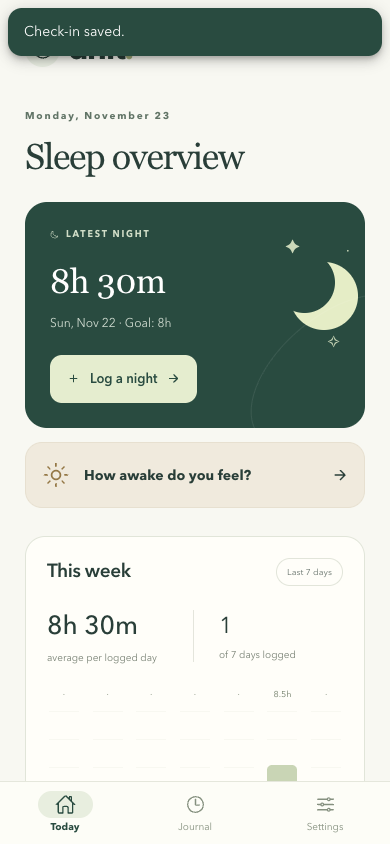

# Drift

A sleep journal for tracking nights, checking in during the day, and understanding your weekly routine. Built by Kevin Zhong with Angular, Ionic, Capacitor, and AWS Amplify.

<p>
  
  
</p>

[Watch the demo](demo.webm)

## Features

- **Log a night:** record bedtime, wake-up time, and notes with a live duration preview.
- **Check in:** track daytime alertness using the seven-point Stanford Sleepiness Scale.
- **Review your week:** see daily sleep totals, your average, and progress toward a personal sleep goal.
- **Manage your journal:** filter, edit, and delete entries, with Undo for accidental deletions.
- **Save to your account:** sign in with email to store your journal in AWS and access it across devices. Refresh the cloud journal to load updates.
- **Use it without an account:** save entries on your device and upload them to your account when you choose.
- **Keep a backup:** export your journal as JSON and restore missing entries.
- **Set reminders:** schedule daily check-in notifications through Capacitor on Android.

## Stack

| Layer | Technology |
| --- | --- |
| Interface | Angular, Ionic, SCSS |
| State | Angular signals |
| Native integration | Capacitor |
| Device storage | Capacitor Preferences |
| Authentication | Amazon Cognito |
| Cloud API and database | AWS Amplify Gen 2, AWS AppSync, Amazon DynamoDB |
| Hosting | AWS Amplify Hosting with GitHub deployments |
| Tests | Jasmine, Karma, Playwright |

## Run locally

Use Node.js 22 and npm.

```sh
git clone https://github.com/woshizgr58/drift-sleeptracker.git
cd drift-sleeptracker/sleeptracker
npm ci
npm start -- --port 8100
```

Open **http://localhost:8100**. A fresh checkout runs with device storage. Follow the AWS setup below to enable accounts and cloud storage.

## AWS setup

Configure an AWS CLI profile with permissions to deploy an Amplify backend. From `sleeptracker`, sign in and start a development sandbox:

```sh
aws login --profile drift --region us-east-2
npx ampx sandbox --profile drift
```

After deployment generates `amplify_outputs.json`, start or restart the frontend in a separate terminal:

```sh
npm start -- --port 8100
```

The startup script copies the generated connection settings into the app. Open **Settings** to create an account, verify your email, and sign in. Use **Upload device entries** to add your existing device journal to your account.

Cloud records use owner-based authorization: each signed-in user can access their own nights, check-ins, and sleep goal.

## Deploy from GitHub

Connect this repository to AWS Amplify Hosting and select the branch to deploy. Enable the monorepo and Amplify Gen 2 backend options, with **`sleeptracker`** as the app root.

The root `amplify.yml` installs dependencies, deploys the backend, and builds the frontend. Amplify publishes the `sleeptracker/www` directory and rebuilds on pushes to the connected branch.

In **Hosting → Rewrites and redirects**, add a **200 rewrite** from `/home` to `/index.html` to support direct navigation and refreshes.

Each deployed branch has its own backend and user accounts, separate from the local development sandbox.

## Android

Install Android Studio, the Android SDK, and JDK 21. From `sleeptracker`, run:

```sh
npm run build
npx cap sync android
npx cap open android
```

Run the app from Android Studio. Enable daily reminders in **Settings** and grant notification permission. **Test in 10 seconds** schedules a notification that opens a check-in when tapped.

## Development

Run these commands from `sleeptracker`:

| Command | Purpose |
| --- | --- |
| `npm start` | Start the development server |
| `npm run build` | Build the app into `www` |
| `npm run lint` | Check TypeScript and templates |
| `npm run typecheck:backend` | Check the Amplify backend types |
| `npm test -- --watch=false --browsers=ChromeHeadless` | Run unit tests with Chrome |
| `npm run test:e2e` | Run browser tests |
| `npm run format` | Format source and test files |
| `npm run demo` | Record a browser walkthrough |

For browser tests, install Chromium if Google Chrome is unavailable:

```sh
npx playwright install chromium
npm run test:e2e
```
